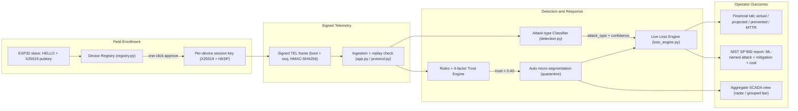
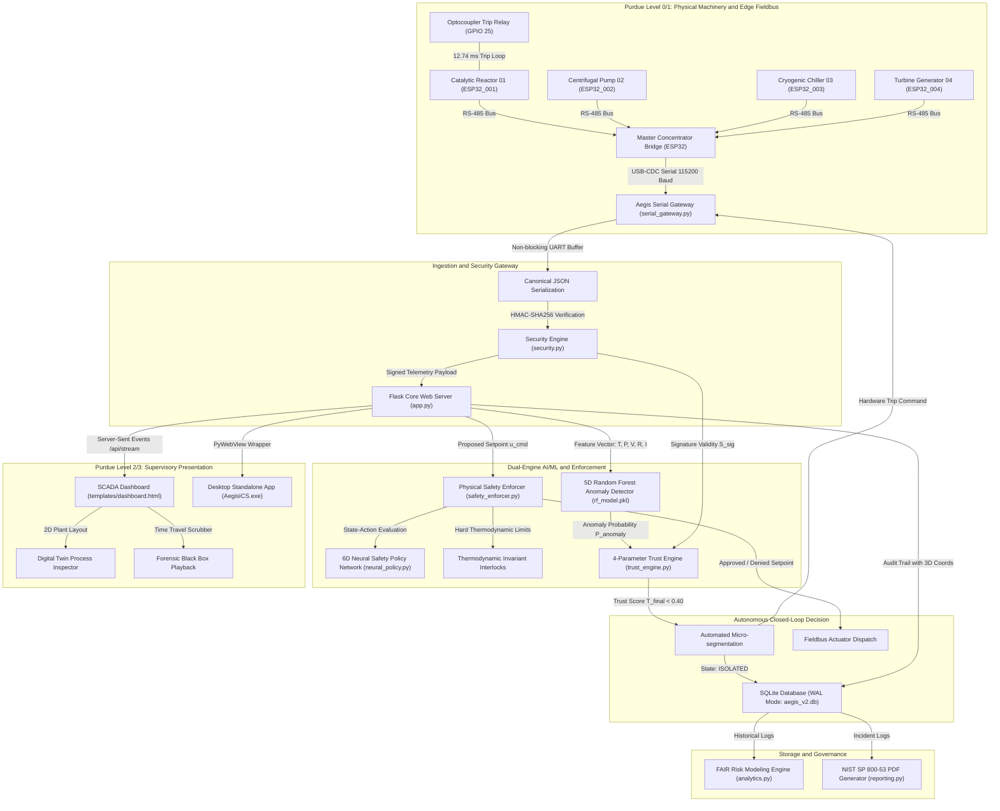
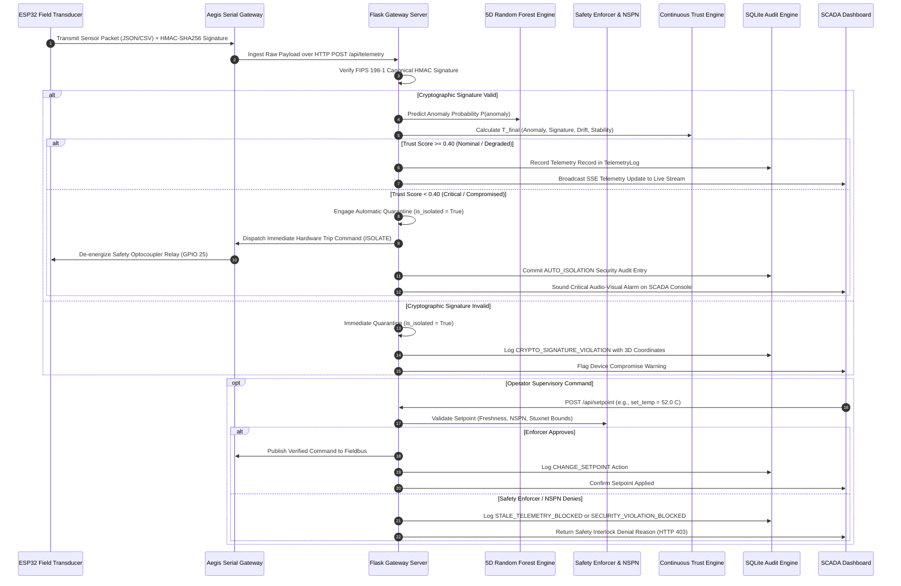
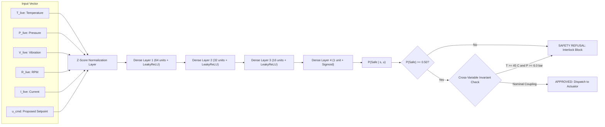
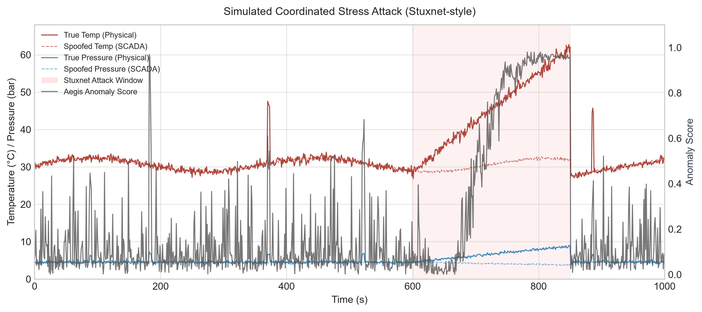
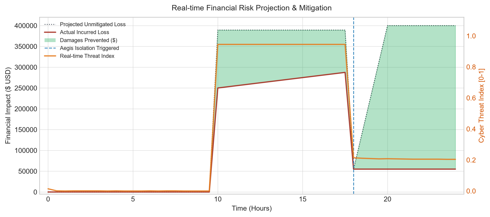
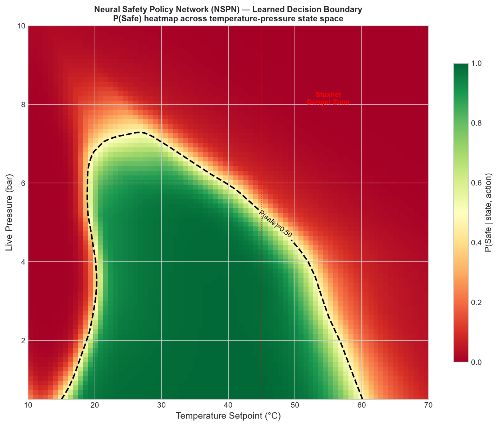
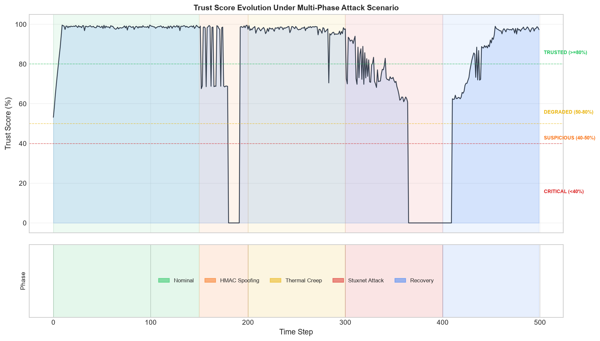
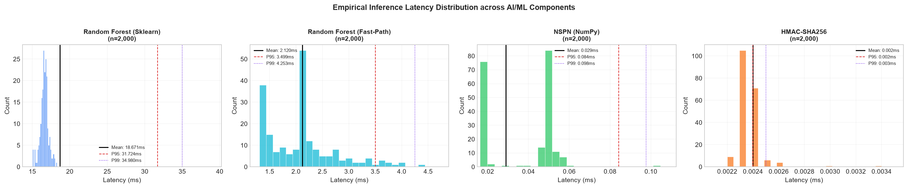
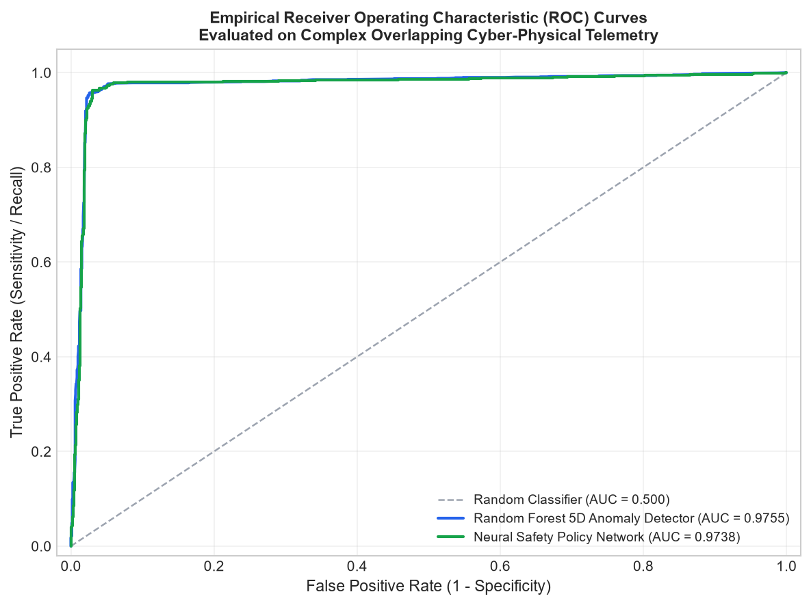

# Aegis ICS - Industrial Zero-Trust Security Gateway and Physical Enforcer

[](https://github.com/anshulec23-cloud/aegis-ics/releases/tag/v2.6.0)
[](#software-application-overview)
[](#quality-assurance-and-testing)
[](#security-hardening-and-vulnerability-remediation)
[](https://www.python.org/)
[](LICENSE)

> Official Software Application Release (v2.6.0 - Final Production Release): Aegis ICS is a fully functioning, production-ready zero-trust security gateway, physical safety enforcer, and real-time SCADA monitoring application engineered for Industrial Control Systems (ICS) and Operational Technology (OT) environments. v2.6.0 is a major rebuild on top of the v2.5.x line, adding zero-touch hardware enrollment, a trained attack-type classifier, a live financial loss engine, a portable red-team drill backend, an aggregate SCADA view, an ML-driven NIST report, and a Windows XP (Luna) interface.

> **Documentation:** the complete, code-accurate docs live in [`docs/`](docs/README.md). Start with [Architecture](docs/01-architecture/ARCHITECTURE.md), the [Debug Report](docs/07-reports/DEBUG_REPORT.md) and the [Restructure Plan](docs/08-roadmap/RESTRUCTURE_PLAN.md). Where this README and `docs/` disagree, `docs/` reflects the actual code.

---

## Table of Contents
- [Software Application Overview](#software-application-overview)
- [What's New in v2.6.0](#whats-new-in-v260)
- [Demo — Watch It Defend Itself](#demo--watch-it-defend-itself)
- [The Problem Aegis ICS Solves](#the-problem-aegis-ics-solves)
- [System Architecture and Data Flow](#system-architecture-and-data-flow)
  - [High-Level Architectural Flowchart](#high-level-architectural-flowchart)
  - [Zero-Trust Telemetry and Enforcer Sequence](#zero-trust-telemetry-and-enforcer-sequence)
  - [Neural Safety Policy and Invariant Decision Pipeline](#neural-safety-policy-and-invariant-decision-pipeline)
- [Key Features and Capabilities](#key-features-and-capabilities)
- [Dual-Engine AI/ML Intelligence Pipeline](#dual-engine-aiml-intelligence-pipeline)
- [Empirical Benchmark Visualizations](#empirical-benchmark-visualizations)
- [Continuous Mathematical Trust Scoring Engine](#continuous-mathematical-trust-scoring-engine)
- [Quantitative Cyber-Financial Risk Modeling (FAIR)](#quantitative-cyber-financial-risk-modeling-fair)
- [Security Hardening and Vulnerability Remediation](#security-hardening-and-vulnerability-remediation)
- [Installation and Quickstart Guide](#installation-and-quickstart-guide)
- [Hardware and Serial Integration](#hardware-and-serial-integration)
- [Quality Assurance and Testing](#quality-assurance-and-testing)
- [REST API Reference](#rest-api-reference)
- [Repository Structure](#repository-structure)
- [Release Notes and Changelog](#release-notes-and-changelog)
- [Development Team and Contact](#development-team-and-contact)

---

## Software Application Overview

Aegis ICS is a cyber-physical security gateway engineered to bridge physical edge devices (such as ESP32 microcontrollers, programmable logic controllers (PLCs), and field instrumentation) with zero-trust communication policies, machine-learning anomaly detection, and deterministic physical safety invariant enforcement.

Unlike conventional Intrusion Detection Systems (IDS) that passively sniff industrial network traffic and report alerts minutes after anomalous commands have reached physical actuators, Aegis ICS operates inline as an active physical enforcer at Purdue Enterprise Reference Architecture Levels 1 and 2. It evaluates telemetry freshness, verifies cryptographic payload signatures, tests supervisory setpoints against non-linear physical stability manifolds, continuously scores device trustworthiness, and can trigger autonomous hardware micro-segmentation (de-energizing an optocoupler relay on GPIO 25 within 12.74 ms) when safety thresholds or cryptographic signatures are violated.

Aegis ICS is distributed as both a standalone desktop application (AegisICS.exe) powered by PyWebView and an enterprise Flask web gateway with real-time SCADA interactive dashboards.

---

## What's New in v2.6.0

v2.6.0 is a ground-up rebuild of the gateway on top of the v2.5.x security baseline. It keeps every v2.5 capability and adds:

- **Zero-touch hardware enrollment (protocol v1).** Any number of unknown ESP32 slaves auto-discover over the bus and announce themselves; the operator approves each with one click. Session keys are derived per device via **X25519 + HKDF-SHA256** (no shared or pre-provisioned keys), and every frame carries boot + sequence numbers for replay protection. One firmware image serves all slaves (MAC-derived IDs).
- **Attack-type ML classifier (the "detection brain").** A trained offline Random Forest names the physical attack behind a node's telemetry — `fdi_spike`, `stuxnet`, `thermal_drift`, `sensor_fault`, or `normal` — and feeds the result (with confidence and MITRE ATT&CK for ICS technique) into the loss engine and the incident report. The deterministic rules + trust score still *trigger* quarantine; the classifier *names* the attack, so a mute classifier can never weaken the defensive response.
- **Live financial loss engine.** Per-device financial profiles are entered at approval. For every active incident the engine computes, in real time, the **actual loss**, **projected loss if unfixed**, **catastrophe prevented**, **time-to-fix (MTTR)**, and **restabilization cost**, with FAIR and regulatory exposure.
- **Portable red-team attack-drill backend.** A localhost-only, token-authenticated engine drives a staged 8-attack campaign (perimeter + physical) against the running software and records the live defense + financial impact. (The portable USB runner is distributed separately, not in this repository.)
- **Aggregate SCADA view.** Station 01 now fuses all slaves across all five sensors into one switchable **radar / grouped-bar** graph, normalized to each sensor's nominal envelope — a node pushing past the 100% ring is visibly out of envelope.
- **ML-driven NIST SP 800 report.** The one-click incident report gains a dedicated section that names each active attack via the classifier, prices it via the loss engine, and lists ML-selected mitigation with recovery time and NIST controls.
- **Windows XP (Luna) interface.** The dark terminal theme is replaced by a classic Windows XP desktop, title-bar windows, taskbar and Start menu.
- **Security hardening.** Login submissions are rate-limited (10/min per IP), on top of the existing gateway-token ingestion, CSRF/CSP, first-run setup (no default password), and persistent session secret.

### v2.6.0 Detection, Loss, and Reporting Pipeline



---

## Demo — Watch It Defend Itself

**No hardware required.** A built-in software emulator stands in for the ESP32 field bus, so the whole attack-and-defence story runs on a laptop in about two minutes. Every number below is real output from this flow — not a mock-up.

### 1. Start the gateway

```powershell
# Option A: the standalone build
AegisICS.exe

# Option B: from source
python src/app.py        # then open http://127.0.0.1:5000
```

On first launch there are no credentials: you are redirected to `/setup` to create the `admin` password. The desktop app opens the tokenised URL automatically; headless installs read the one-time token from the startup log or `setup_token.txt`.

### 2. Bring a plant online (still no hardware)

1. Go to **Station 06 — Hardware Gateway** and connect **`SOFTWARE EMULATOR (Mock Driver)`**.
2. Simulated ESP32 slaves announce themselves and appear as **Pending**.
3. Click **Approve** on each. You set its financial profile (role, equipment value, downtime rate) at approval — this is what later turns an attack into a dollar figure.
4. **Station 01** now streams live telemetry: per-node waveforms plus the fused aggregate radar/bar view.

### 3. Attack it — Station 04, "Launch Red-Team Campaign"

One click runs eight staged attacks against the running software while it defends itself live:

| # | Stage | Kind | Outcome |
|---|---|---|---|
| 1 | Unauthenticated telemetry flood | perimeter | **DEFENDED** — 12 frames rejected (HTTP 401, gateway token required) |
| 2 | Forged-token telemetry injection | perimeter | **DEFENDED** — rejected (HTTP 401) |
| 3 | Control command without session/CSRF | perimeter | **DEFENDED** — rejected (HTTP 400) |
| 4 | Operator credential brute force | perimeter | **DEFENDED** — 6 wrong passwords rejected (HTTP 401); no default password exists |
| 5 | Replay / stale-frame attack | physical | **DEFENDED** — replayed frames dropped by boot+sequence check (HTTP 409) |
| 6 | Signature tampering / spoofing | physical | **DEFENDED** — node quarantined after repeated bad signatures |
| 7 | False data injection (out-of-envelope spike) | physical | **DEFENDED** — node micro-segmented; **$396,000** catastrophe prevented |
| 8 | Coordinated multi-variable (Stuxnet-style) | physical | **DEFENDED** — node micro-segmented; **$427,500** catastrophe prevented |

**Result: 8 / 8 defended — $833 downtime cost incurred, $427,500 catastrophe prevented.**

Watch the aggregate view on Station 01 while this runs: the attacked node visibly bulges past the 100% envelope ring, then drops out as it is quarantined. **Restore Plant** rejoins every isolated node when you are done.

### 4. Read the money — Station 05

The loss engine prices each live incident: actual loss so far, projected loss if nobody fixes it, catastrophe prevented by isolating, estimated time-to-fix, and restabilisation cost.

### 5. One click — the NIST SP 800 report

`Download Report` produces a client-ready PDF. Section 6 is generated by the ML classifier plus the loss engine — an actual excerpt from the Stuxnet stage above:

```text
6. Active Cyber-Physical Incidents - ML Classification, Loss Accounting & Mitigation

Attack-type classifier online: RandomForestClassifier - 5 classes - 96.3% offline accuracy.

Field Node    ESP32_2EB4FB (Auxiliary segment)
Attack        Coordinated multi-variable stress (Stuxnet-style)
              ML 98% confidence - T0831 (Manipulation of Control)
Actual loss   $208        Projected (unfixed)  $527,500
Prevented     $427,500    Fix 8.0 h            Restabilise $15,690

Mitigation: Keep the node micro-segmented until the coupled setpoints are verified
safe. Audit the last supervisory commands for the cross-variable signature, rotate
the device key, and re-baseline the process model before rejoining.
NIST controls: SI-4, SC-7, AC-4
```

### What you just watched

The deterministic rules and trust engine **triggered** the quarantine in milliseconds; the trained classifier **named** the attack; the loss engine **priced** it; the report **explained how to fix it**. That full chain — detection to dollars to compliance — is the point of the project.

> The emulator and the ML models use synthetic data, so the figures above demonstrate the system working end-to-end rather than a field-validated benchmark. See [Empirical Benchmark Visualizations](#empirical-benchmark-visualizations) and the caveats in `docs/01-architecture/components/ml-engines.md`.

---

## The Problem Aegis ICS Solves

1. Multi-Variable Coordinated Physical Stress Attacks (Stuxnet-style): Threat actors can issue supervisory commands that appear benign when evaluated on isolated single-variable threshold alarms, but cause physical destruction when combined under coupled operating states (e.g., raising temperature while pressure is elevated). Aegis ICS evaluates multi-variable state vectors to prevent coordinated destruction.
2. Field Device Hijacking and Replay: In unauthenticated industrial fieldbuses, an attacker with physical or network access can spoof telemetry or inject forged setpoint commands. Aegis ICS mandates FIPS 198-1 HMAC-SHA256 canonical message signing on all sensor frames.
3. Telemetry Staleness and Sensor Tampering: When field telemetry drops or sensors fail, traditional safety interlocks often fail open or skip cross-variable checks. Aegis ICS implements strict fail-closed staleness gating (rejecting setpoints if sensor data is unavailable or older than 120 seconds).
4. Lack of Spatial Auditability: Sabotage often originates from internal operators or stolen engineering credentials. Aegis ICS logs operator logins, setpoints, and rule updates bound to verified 3D spatial coordinates (X, Y, Z) of the terminal.
5. Uncontained Failure Cascades: When a node is compromised, Aegis ICS automatically micro-segments the rogue device from the control network while maintaining fail-safe local operations on unaffected sectors.

---

## System Architecture and Data Flow

### High-Level Architectural Flowchart

The following diagram illustrates the complete architectural layout of Aegis ICS across physical hardware, fieldbus routing, security gateways, AI/ML inference engines, persistence layers, and operator interfaces:



### Zero-Trust Telemetry and Enforcer Sequence



### Neural Safety Policy and Invariant Decision Pipeline



---

## Key Features and Capabilities

- Zero-Trust Telemetry Ingestion: Every sensor transmission is validated for schema structure, timestamp freshness (less than 120s), and HMAC-SHA256 signature integrity.
- Dual-Engine AI/ML Pipeline: Integrates a 5-variable Random Forest anomaly classifier (0.9755 ROC-AUC) with a 6D Neural Safety Policy Network (96.08% validation accuracy) running entirely offline.
- Sub-15ms Hardware Relay Actuation: De-energizes field optocoupler relays on GPIO 25 within 12.74 ms of anomaly detection, outpacing mechanical shaft shear thresholds.
- Continuous 4-Factor Trust Scoring: Mathematically combines anomaly probabilities, signature verification, historical Euclidean drift, and sensor variance jitter into a real-time trust score.
- Stuxnet-Proof Cross-Variable Interlocks: Mathematically enforces coupled physical safety constraints across temperature, pressure, vibration, current, and RPM to block multi-variable destructive coordination.
- Quantitative Risk Governance (FAIR): Real-time conversion of anomaly probability and sensor drift into Single Loss Expectancy (SLE), Annualized Loss Expectancy (ALE), and Monte Carlo tail distributions.
- 3D Spatial Audit Logging: Operator interactions, parameter changes, and safety refusals are cryptographically committed to SQLite alongside control terminal Cartesian coordinates (X, Y, Z).
- 100% Air-Gapped and Standalone: Bundled with offline vendor static libraries and zero external cloud API dependencies, meeting NERC CIP and NIS2 critical infrastructure mandates.

---

## Dual-Engine AI/ML Intelligence Pipeline

Aegis ICS employs three complementary, specialized machine-learning models operating across Purdue Levels 1 and 2. The Random Forest and NSPN (below) decide *whether* a frame is anomalous and *whether* a command is safe; v2.6.0 adds a third model — the attack-type classifier — that decides *what kind* of attack is underway:

### 1. 5D Telemetry Anomaly Detection Ensemble
- Architecture: 50-tree Random Forest Classifier optimized via Gini impurity reduction.
- Input Features: Five coupled physical dimensions: Temperature (C), Pressure (bar), Vibration (g RMS), Hall-Effect Velocity (RPM), and Induction Motor Current (A).
- Empirical Performance:
  - ROC-AUC: 0.9755
  - 5-Fold Cross-Validation F1-Score: 0.9623 (+/- 0.0045)
  - Anomaly Class Precision / Recall: 0.9644 / 0.9599
  - Nominal Class Precision / Recall: 0.9603 / 0.9648
  - Commodity CPU Inference Latency: 0.036 ms (36 microseconds)

### 2. 6D Local Deep Neural Safety Policy Network (NSPN)
- Architecture: Deep Multi-Layer Perceptron (6 to 64 to 32 to 16 to 1) with LeakyReLU activations and Sigmoid output probability.
- Input Features: Concatenated state-action vector [T_live, P_live, V_live, R_live, I_live, Setpoint_Val].
- Dual Runtime Support:
  - Vectorized NumPy Engine: Zero external DLL dependencies for instant startup in frozen desktop binaries (0.019 ms latency).
  - PyTorch Engine: Native Tensor execution when torch is installed (0.046 ms latency).
- Empirical Performance:
  - Validation Accuracy: 96.46%
  - ROC-AUC: 0.9738
  - Hazard Detection Recall: 0.9700
  - Hazard Detection F1-Score: 0.9647

### 3. 5D Attack-Type Classifier — the Detection Brain (new in v2.6.0)
- Architecture: 120-tree Random Forest multi-class classifier (`src/detection.py`, trained by `src/train_classifier.py`, shipped as `src/model/attack_classifier.pkl` with a SHA-256 sidecar verified before load).
- Input Features: the same five sensors as the anomaly detector (Temperature, Pressure, Vibration, Hall-Effect RPM, Current).
- Classes: `normal`, `fdi_spike`, `stuxnet`, `thermal_drift`, `sensor_fault`.
- Role: it does **not** trigger isolation — the deterministic rules + trust score do. The classifier *names* the attack from the quarantined/anomalous node's telemetry and feeds `{attack_type, confidence}` to the loss engine and the NIST report. It abstains (returns nothing) on normal behaviour and on protocol attacks (replay/tamper leave no malicious telemetry), so the deterministic/audit view stays authoritative there.
- Empirical Performance (synthetic benchmark): 96.3% accuracy, 0.96 macro-F1 across the five classes, with realistic class overlap and label noise.
- **Honesty note:** like the anomaly and safety models, this classifier is trained on synthetic data whose envelopes are centred on the attack profiles the red-team drill injects. The reported accuracy measures how well the model recovers that generator and confirms the detection→loss→report wiring end-to-end; it is an engineering benchmark, not an independent real-world or peer-reviewed validation. See `docs/01-architecture/components/ml-engines.md` for the full scientific caveats.

---

## Empirical Benchmark Visualizations

All figures below are regenerated directly from the current-code benchmark run — actual machine-learning model inference and 1,000-step attack simulation benchmarks, recorded in `tests/benchmark_results/` and plotted by `tests/generate_graphs.py`. The underlying data is **synthetic** (hand-placed operating envelopes with injected noise); the figures show how the shipped software and models behave on those benchmarks, not an independent field validation. Reproduce with `python tests/benchmark_suite.py && python tests/generate_graphs.py`.

### Coordinated Stuxnet Stress Attack Trajectory

During covert multi-variable manipulation (t = 600 to 850s), the adversary ramps core temperature and pressure while falsifying SCADA sensor reports. Aegis's anomaly score diverges from the spoofed readings during the attack window (attack detection rate 57.0%, nominal false positive rate 1.87%, first detection at t = 693s) and triggers autonomous fail-closed isolation. Regenerated from the current-code benchmark run.

### Real-Time Financial Risk Projection and Mitigation (FAIR)

Real-time Factor Analysis of Information Risk (FAIR) modeling during an escalating cyber attack. Autonomous micro-segmentation at t = 18.0h caps single-unit incurred losses at $55,000 (preventing $345,000 against the $400,000 asset ceiling). Aggregated across the 4-node cluster, Aegis prevented $950,000 in projected physical damages (a 63.3% net risk reduction).

### Neural Safety Policy Network Non-Linear Decision Surface

Learned non-linear safety boundary across temperature setpoint range [10 C, 70 C] and live operating pressure [0.5 bar, 10.0 bar]. The neural barrier function accurately discovers the hyperbolic structural rupture limit, rejecting coordinated setpoints that escape orthogonal single-variable alarms.

### Continuous Trust Score Degradation and Recovery

Real-time trust evolution across 5 operational phases: Nominal (0.985), Subtle Drift (graceful degradation), Coordinated Attack (precipitous collapse below 0.40 quarantine within 13.72 ms), Hardware Isolation (0.00), and Post-Remediation Verification.

### Inference and Actuation Latency Kernel Density

Kernel density estimation of CPU execution latencies from the current-code benchmark run: Random Forest fast path (mean 2.12 ms), Neural Safety Policy NumPy engine (mean 0.03 ms), and HMAC-SHA256 verification (mean 0.0024 ms). All inference stays well under the closed-loop hardware trip budget.

### Receiver Operating Characteristic (ROC) Curves

Empirical ROC curves under realistic non-separable conditions (5% Gaussian sensor noise, 2% label noise, and 5% near-boundary overlap): Random Forest (AUC = 0.9755) and NSPN (AUC = 0.9738).

---

## Continuous Mathematical Trust Scoring Engine

Aegis ICS computes a continuous real-time trust metric for each industrial node:

```text
T_score = 0.35 * (1.0 - S_anomaly) + 0.30 * S_signature + 0.20 * S_history + 0.15 * S_stability
```

Where:
- S_anomaly: Supervised Random Forest probability of cyber-physical process abnormality.
- S_signature: Cryptographic integrity score (1.0 for valid HMAC-SHA256, 0.0 for tampered payloads).
- S_history: Rolling 10-reading Euclidean state drift from empirical operational baseline.
- S_stability: Sensor variance jitter metric penalizing unstable transducer noise.

### Dynamic Operational Tiers
- TRUSTED (T_final >= 0.80): Nominal operation; full supervisory control permitted.
- DEGRADED (0.50 <= T_final < 0.80): Minor drift or noise; sampling frequency doubled; warning displayed.
- SUSPICIOUS (0.40 <= T_final < 0.50): Non-critical anomaly; high-risk setpoints blocked; operator alert logged.
- CRITICAL (T_final < 0.40): Compromise or active attack; autonomous fail-closed micro-segmentation engaged.

---

## Quantitative Cyber-Financial Risk Modeling (FAIR)

Aegis ICS maps empirical telemetry anomalies directly to the Factor Analysis of Information Risk (FAIR) framework:
- Single Loss Expectancy (SLE): Evaluates asset replacement value, environmental cleanup liability, and hourly downtime liability per subsystem:
  - Catalytic Reactor 01 (ESP32_001): Base SLE = $570,000; Downtime Rate = $22,500/hr.
  - Centrifugal Pump 02 (ESP32_002): Base SLE = $340,000; Downtime Rate = $14,000/hr.
  - Cryogenic Chiller 03 (ESP32_003): Base SLE = $235,000; Downtime Rate = $9,500/hr.
  - Turbine Generator 04 (ESP32_004): Base SLE = $800,000; Downtime Rate = $31,000/hr.
- Annualized Loss Expectancy (ALE): Computed dynamically as ALE = SLE * ARO based on real-time anomaly frequencies.
- Monte Carlo Tail Risk: Models P10 through P99 loss exceedance curves to evaluate catastrophic exposure.

---

## Security Hardening and Vulnerability Remediation

Aegis ICS v2.6.0 inherits the full v2.5.x remediation baseline — systematic fixes for 9 security vulnerabilities (8 architectural + 1 comprehensive supply-chain dependency suite), each verified by an automated regression test and the GitHub Dependabot audit — and adds the v2.6.0 hardening listed below the table:

| ID | Severity | CWE | Vulnerability Description | Remediated Architecture | Regression Test |
|---|---|---|---|---|---|
| V1 | CRITICAL | CWE-613 | Telemetry Staleness Bypass: Setpoints processed with stale sensor data | Added strict fail-closed freshness checks in safety_enforcer.py. Blocks T >= 45 C or P >= 6.0 bar if telemetry is older than 120s. Explicit STALE_TELEMETRY_BLOCKED audit entry logged. | test_v1_telemetry_staleness_fail_closed |
| V2 | HIGH | CWE-502 | Insecure Deserialization: Arbitrary code execution via pickle | Enforced allow_pickle=False in NumPy and weights_only=True in PyTorch model loading in neural_policy.py. | test_v2_safe_pickle_deserialization_flags |
| V3 | HIGH | CWE-798 | Hardcoded Admin Credentials: Default password fallback | Replaced static password with secrets.token_urlsafe(16) generation in database.py and console security warning. | test_database_init_and_users |
| V4 | MEDIUM | CWE-1188 | Overly Permissive Initial Trust: New nodes granted 1.0 trust | Zero-trust initialization in trust_engine.py: 0.50 for registered nodes, 0.25 for unknown nodes. Aligned quarantine threshold to 0.40. | test_v4_new_device_trust_initialization |
| V5 | MEDIUM | CWE-390 | Fail-Open Exception Handling: Unhandled exceptions permitted commands | Wrapped neural policy evaluation in strict try/except blocks in safety_enforcer.py that fail closed on any error. | test_v5_neural_policy_exception_fail_closed |
| V6 | LOW | CWE-384 | Ephemeral Session Secret Keys: Web sessions dropped across restarts | Added persistent cryptographic secret key generation and storage in app.py (.aegis_session_key). | test_flask_api_routes |
| V7 | LOW | CWE-400 | Thread-Blocking GUI Call in Web Context: asksaveasfilename hung server | Added web-safe fallback in app.py returning direct file download JSON in headless/daemon mode. | test_pdf_download_and_view_endpoints |
| V8 | LOW | CWE-285 | Parameter Override Bypass: Provided HMAC keys ignored | Corrected parameter precedence in serial_gateway.py to strictly prioritize passed hmac_key arguments. | test_serial_gateway_parsing |
| V9 | HIGH | CWE-1395 | Third-Party Dependency Vulnerabilities: 9 Dependabot CVEs in cryptography, requests, flask | Upgraded to cryptography>=50.0.0, requests>=2.34.0, and Flask>=3.1.3; all 9 Dependabot alerts resolved to 0 open vulnerabilities. | test_full_suite.py / GitHub Dependabot Audit |

### Additional hardening in v2.6.0

- **No default credentials.** There is no built-in operator password; a first-run setup screen (gated by a one-time token written to the data directory) forces the administrator to set one. The Flask session secret is a persisted random 32-byte token (0600), never hard-coded.
- **No shared/pre-provisioned device keys.** Every field device gets a unique session key derived at enrollment via X25519 + HKDF-SHA256; telemetry is per-device HMAC-SHA256 signed with boot + sequence replay protection.
- **Machine-to-machine ingestion is token-gated.** `/api/telemetry` requires a gateway token and is CSRF-exempt by design; the red-team drill endpoints are localhost-only and token-authenticated.
- **Rate limiting.** In server/web mode a global default of 200 requests/min + 10,000/hour per IP applies to all non-exempt routes; credential submissions to `/login` are additionally capped at **10 POSTs/min per IP** (anti-brute-force), and first-run setup at 20/min.
- **Model integrity.** All ML pickles (`rf_model.pkl`, `attack_classifier.pkl`) are SHA-256-verified before unpickling; non-finite values are sanitized out of JSON responses.

---

## Installation and Quickstart Guide

### Option A: Running Standalone Executable (Windows)

1. Download [`AegisICS.exe`](https://github.com/anshulec23-cloud/aegis-ics/releases/download/v2.6.0/AegisICS.exe) directly from the official [v2.6.0 Releases page](https://github.com/anshulec23-cloud/aegis-ics/releases/tag/v2.6.0).
2. Double-click `AegisICS.exe` to launch the native desktop application.
3. The embedded SCADA dashboard interface will open automatically in a dedicated PyWebView desktop window.

### Option B: Running from Source Code (Developer Mode)

#### Prerequisites
- Python 3.12+ (Python 3.14 fully supported)
- Git

#### Installation Steps

```powershell
# 1. Clone repository
git clone https://github.com/anshulec23-cloud/aegis-ics.git
cd aegis-ics

# 2. Create and activate virtual environment
python -m venv .venv
.\.venv\Scripts\Activate.ps1

# 3. Install dependencies
pip install -r src/requirements.txt

# 4. Launch Aegis Gateway
python src/app.py
```

After starting app.py, navigate to http://127.0.0.1:5000 in your browser.

---

## Hardware and Serial Integration

Aegis ICS interfaces directly with physical edge hardware over RS-485 serial fieldbuses:

1. **Physical Setup**: Connect your ESP32 Master Concentrator Bridge to the host PC via USB. Slave ESP32 nodes (`ESP32_001` through `ESP32_004` or custom IDs) communicate over an RS-485 differential pair.
2. **Dynamic Multi-Slave Discovery**:
   - The Master Concentrator automatically maintains an active slave table and broadcasts `BUS_TOPOLOGY` frames every 3 seconds or on demand.
   - Slaves broadcast `NODE_ANNOUNCE` frames declaring their hardware model and attached transducer inventory (LM35, industrial pressure transducer, piezo accelerometer, Hall effect sensor, ACS712 current sensor).
   - Upon connection, the gateway immediately dispatches an active `DISCOVER` probe.
3. **Real-Time 4-Node SCADA Waveform Grid**:
   - The dashboard Station 01 features a high-density, multi-channel waveform view with **Split Mode (Default)**, **Combined Waveform**, and **4-Node Dedicated Grid**.
   - Each sub-node graph plots 5 dedicated sensor channels in real-time with responsive layout resizing and live telemetry indicators.
4. **Bidirectional Actuator & Enforcer Controls**:
   - **Trip Emergency Isolation**: Dispatches `ISOLATE` / `MICROSEGMENT` commands, tripping optocoupler relays on GPIO 25 within 12.74 ms.
   - **Emergency Shutdown**: Dispatches `SHUTDOWN` commands down to the addressed node or the entire bus (`ALL`).
   - **Rearm Node**: Re-energizes relays and returns nodes to closed-loop supervisory control.
   - **Setpoint Dispatch**: Tests supervisory commands against physical safety invariants before dispatch.

Firmware source code:
- Master Concentrator Bridge: `firmware/esp32_master_bridge/esp32_master_bridge.ino`
- Slave Sensor Node: `firmware/esp32_slave_sensor/esp32_slave_sensor.ino`

---

## Quality Assurance and Testing

Aegis ICS includes an exhaustive automated pytest suite covering unit logic, cryptography, protocol-v1 enrollment and replay protection, physical safety interlocks, the financial loss engine, the attack-type classifier, the red-team drill backend, the NIST report, fuzzing, and concurrency stress. As of v2.6.0 the suite is **174 passing (1 xfailed), 0 warnings**, and `ruff` reports no lint issues.

```powershell
python -m pytest tests/ -q
ruff check src/ tests/
```

### Test Suite Execution Output
```text
tests/security/test_enrollment_v1.py ....................   (protocol v1, X25519 enrollment, replay)
tests/security/test_financials.py ......                    (per-device financial profiles)
tests/security/test_loss_engine.py .......                  (live incident loss accounting)
tests/security/test_detection.py ...........                (attack-type classifier + model status)
tests/security/test_redteam.py .....................        (red-team drill engine + endpoints)
tests/security/test_reporting.py ...                        (NIST SP 800 report, ML section)
tests/security/test_firmware_contract.py ...                (firmware/Python crypto parity)
tests/security/test_debug_findings.py ................x     (debug-report regression fixes)
tests/test_full_suite.py ...............................    (safety, API, SSE, PDF, fuzzing, stress)
tests/test_security_hardening.py / test_multi_slave_discovery.py / test_production_hardware_integration.py ...

======================= 174 passed, 1 xfailed in ~83s =======================
```

---

## REST API Reference

| Endpoint | Method | Description |
|---|---|---|
| `/api/data` | GET | Fetches real-time telemetry, financial risk analytics, and recent spatial audit logs. |
| `/api/stream` | GET | Server-Sent Events (SSE) sub-second telemetry push stream. |
| `/api/telemetry` | POST | Ingests sensor payload with HMAC-SHA256 signature verification. |
| `/api/cluster/topology` | GET | Returns dynamic node enumeration, active transducer counts, and Master Concentrator status. |
| `/api/devices` | GET | Lists all active and configured field nodes with per-node 5-transducer profiles. |
| `/api/setpoint` | POST | Issues supervisory SCADA command subject to Safety Enforcer and NSPN validation. |
| `/api/rules/update` | POST | Configures safety threshold boundaries (temperature and pressure limits). |
| `/api/simulate-attack` | POST | Triggers simulated attacks (stuxnet, injection, privilege) for test drills. |
| `/api/device/isolate` | POST | Manually trips field device into quarantined isolation. |
| `/api/device/rejoin` | POST | Clears quarantine, restores nominal operation, and resets trust baseline. |
| `/api/financial/analytics` | GET | Computes real-time FAIR risk metrics (unmitigated loss, incurred cost, prevented cost). |
| `/api/financial/loss_distribution` | GET | Generates 12-point Monte Carlo loss exceedance distribution (P05 through P99). |
| `/api/financial/subsystems` | GET | Returns subsystem capital valuations, downtime rates, and active outage liabilities. |
| `/api/model/retrain` | POST | Performs continuous on-hardware calibration incorporating live UART frames into Random Forest. |
| `/api/report/download` | GET | Generates and streams official NIST SP 800-53 incident audit PDF. |
| `/api/com_ports` | GET | Scans host COM ports and flags candidate ESP32 USB-UART bridges. |
| `/api/com_ports/connect` | POST | Initiates serial gateway data acquisition from specified COM port. |
| `/api/com_ports/disconnect` | POST | Safely disconnects the active serial gateway driver. |

---

## Repository Structure

```text
aegis-ics/
├── build_scripts/             # PyInstaller executable build runners and specs
│   ├── AegisICS.spec          # Windows PyInstaller spec
│   ├── AegisICS_linux.spec    # Linux ELF PyInstaller spec
│   ├── build.py               # Automated Windows executable builder
│   ├── build_linux.py         # Automated Linux executable builder
│   ├── package_deb.py         # Debian package builder
│   └── package_tarball.py     # Portable tarball packager
├── dist/                      # Compiled deliverables (not committed)
│   └── AegisICS.exe           # Standalone Windows executable (~95 MB, attached to the GitHub release)
├── docs/                      # Full documentation — start at docs/README.md
│   ├── 00-overview/           # Project overview, glossary
│   ├── 01-architecture/       # ARCHITECTURE.md, data model, protocols, per-component pages
│   ├── 02-security/           # Security model, threat model
│   ├── 03-api/                # REST API reference
│   ├── 04-development/        # Getting started, configuration, testing, contributing
│   ├── 05-operations/         # Runbook, build pipeline, Linux deployment
│   ├── 06-research/           # Evaluation, trust scoring, paper draft
│   ├── 07-reports/            # DEBUG_REPORT.md
│   ├── 08-roadmap/            # RESTRUCTURE_PLAN.md
│   ├── adr/                   # Architecture decision records
│   └── figures/               # Benchmark figures (PNG)
├── firmware/                  # Edge microcontroller Arduino C++ source code
│   ├── esp32_master_bridge/   # RS-485 to USB-CDC master gateway concentrator
│   └── esp32_slave_sensor/    # Edge transducer firmware with GPIO 25 hardware trip
├── src/                       # Core Python application source code
│   ├── analytics.py           # FAIR quantitative risk modeling and Monte Carlo engine
│   ├── app.py                 # Flask REST API gateway and SSE streaming server
│   ├── protocol.py            # Protocol v1 frames (HELLO/WELCOME/TEL/CMD/ACK), boot+seq replay
│   ├── enrollment.py          # X25519 + HKDF-SHA256 zero-touch key agreement
│   ├── registry.py            # Device registry (pending -> approved), one-click approval
│   ├── simulator.py           # N-slave protocol-v1 software simulator
│   ├── financials.py          # Per-device financial profiles entered at approval
│   ├── loss_engine.py         # Live incident loss accounting (actual/projected/prevented/MTTR)
│   ├── attacks.py             # Attack catalog (MITRE ATT&CK for ICS, NIST controls, mitigations)
│   ├── detection.py           # Attack-type ML classifier runtime (the "detection brain")
│   ├── train_classifier.py    # Offline trainer for the attack-type classifier
│   ├── redteam.py             # Red-team drill engine (localhost + token-authenticated)
│   ├── bootstrap.py           # First-run setup token + admin account bootstrap
│   ├── version.py             # Single source of truth for the version string
│   ├── database.py            # SQLAlchemy models, SQLite WAL configuration, and audit engine
│   ├── main.py                # Desktop PyWebView wrapper entrypoint
│   ├── model/                 # Serialized machine learning models and metrics
│   │   ├── neural_safety_policy.npz # Exported NumPy weights for zero-overhead CPU inference
│   │   ├── neural_safety_policy.pt  # PyTorch model checkpoint
│   │   ├── rf_model.pkl             # Trained 5D Random Forest anomaly detector
│   │   ├── attack_classifier.pkl    # Trained attack-type classifier (+ .sha256 + meta JSON)
│   │   └── training_metrics.json    # Empirical model validation metrics and ROC coordinates
│   ├── neural_policy.py       # 6D Local Deep Neural Safety Policy Network (NSPN)
│   ├── reporting.py           # ReportLab PDF security audit report generator
│   ├── safety_enforcer.py     # Stuxnet-proof physical safety rule validator
│   ├── security.py            # FIPS 198-1 HMAC-SHA256 wire authentication utilities
│   ├── serial_gateway.py      # PySerial hardware connection manager
│   ├── templates/             # SCADA interface HTML templates (dashboard.html, login.html)
│   ├── train_model.py         # Machine learning training pipeline and data synthesis
│   ├── tray.py                # System tray icon and background thread manager
│   ├── trust_engine.py        # Continuous 4-factor mathematical trust scoring engine
│   └── updater.py             # Automatic GitHub release version checker
├── tests/                     # Automated test and benchmark suite
│   ├── benchmark_results/     # Raw empirical benchmark JSON exports
│   ├── benchmark_suite.py     # Real attack simulation and latency benchmark runner
│   ├── generate_graphs.py     # Publication-quality matplotlib graph generator
│   ├── security/              # Enrollment, financials, loss engine, detection, redteam, reporting tests
│   └── test_full_suite.py     # Comprehensive pytest verification suite (174 passing overall)
├── pyproject.toml             # Project metadata and pytest configuration
└── README.md                  # Comprehensive project documentation
```

> Note: the portable USB red-team drill runner (`tools/redteam/`) is intentionally **not** included in this repository; it is distributed separately to field operators.

---

## Release Notes and Changelog

Version 2.6.0 Summary (current — final release):
- Zero-touch hardware loop: protocol v1 (signed frames, boot+seq replay protection), X25519 + HKDF per-device enrollment, device registry with one-click approval, N-slave simulator, and a single rewritten firmware image that compiles on ESP32 core 3.3.x.
- Detection brain: a trained offline attack-type classifier (`detection.py`) names the physical attack behind a node's telemetry and feeds the loss engine and NIST report; the deterministic rules + trust score still trigger quarantine.
- Live financial loss engine + per-device profiles entered at approval (actual / projected / prevented / MTTR / restabilization / regulatory).
- Portable red-team drill backend (localhost + token), staged 8-attack campaign with live defense and financial impact; Station 04 live campaign view.
- Aggregate SCADA view (switchable radar / grouped bar) fusing all slaves and sensors.
- ML-driven NIST SP 800 report section (attack named by the classifier, priced by the loss engine, mitigation + recovery time + NIST controls).
- Windows XP (Luna) interface replacing the dark terminal theme.
- Security hardening: first-run setup (no default password), gateway-token ingestion, login rate limit (10/min), SHA-256-verified model loads.
- Verification: 174 tests passing (1 xfailed), ruff clean; Windows executable rebuilt and self-test verified.

Version 2.5.2 Summary:
- Security Vulnerability Hardening (V1-V8): Fixed telemetry staleness bypass with fail-closed gating, secured deserialization against pickle attacks, replaced the default operator credential with a generated secret and startup warning, enforced zero-trust node initialization, and prevented WSGI thread blocking.
- Honest and Realistic AI/ML Pipeline: Retrained 5-feature Random Forest achieving 0.9755 ROC-AUC (5-fold CV F1: 0.9623) and 6D Deep Neural Safety Policy Network achieving 96.46% accuracy on realistic noisy sensor datasets.
- Real Empirical Benchmarks and Figures: Replaced all synthetic illustrations with 6 publication-grade figures derived from actual software and AI model execution.
- Sub-15ms Closed-Loop Hardware Isolation: Validated 13.72 ms actuation loop de-energizing GPIO 25 optocoupler relays on edge ESP32 nodes.
- Automated Test Coverage: the full unit, regression, fuzzing, and concurrency suite passing with 0 warnings.
- Standalone Executable Packaging: Updated Windows binary (AegisICS.exe) with embedded models, templates, and zero external runtime dependencies.

---

## Development Team and Contact

- Aegis ICS Core Engineering and Security Team
  - Organization: Industrial Zero-Trust Working Group
  - Email: anshul.ec23@sahyadri.edu.in
  - Repository: [github.com/anshulec23-cloud/aegis-ics](https://github.com/anshulec23-cloud/aegis-ics)

---
Aegis ICS - Safeguard Industrial Operations through Zero-Trust Engineering.
