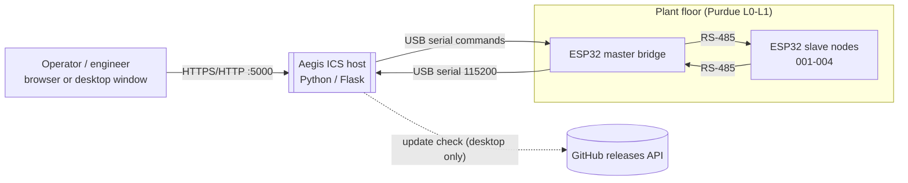
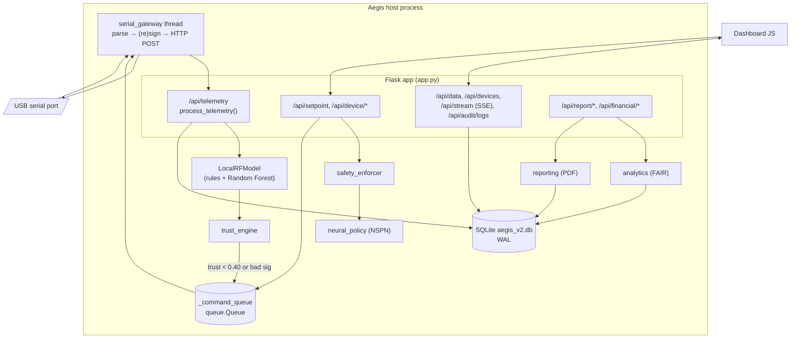
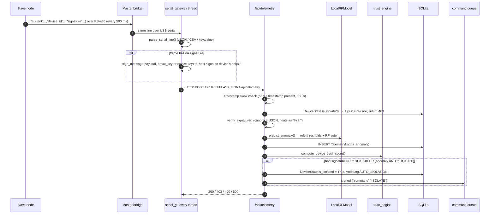
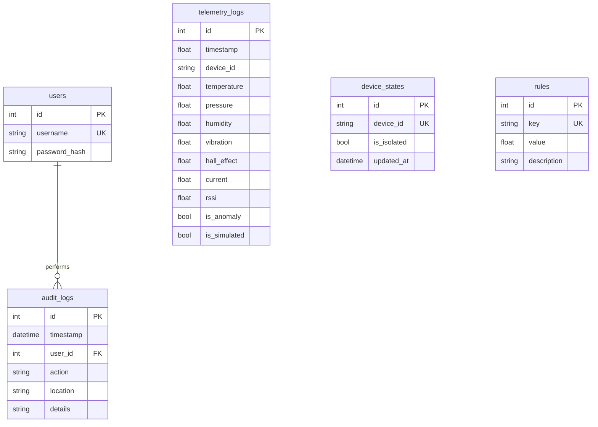

# Aegis ICS — Architecture

> **Status:** describes the code **as it is in v2.5.2/2.5.3**, not as the marketing README describes it.
> Where the two differ, this document follows the code and flags the gap with ⚠️.
> The target architecture is in [`../08-roadmap/RESTRUCTURE_PLAN.md`](../08-roadmap/RESTRUCTURE_PLAN.md).

---

## 1. What the system is

Aegis ICS is a **cyber-physical security gateway** for a small industrial cell. It sits between field devices (ESP32 sensor nodes on an RS-485 bus) and human operators, and it does five things:

1. **Ingests** sensor telemetry (temperature, pressure, vibration, RPM, current) from field nodes.
2. **Authenticates** each frame with a per-device HMAC-SHA256 signature.
3. **Scores** each node continuously: rule thresholds plus a Random Forest classifier feed a 4-factor trust score.
4. **Enforces**: operator setpoint commands are checked by a safety enforcer (database limits, a neural safety policy and hard physics invariants). Untrusted nodes are quarantined, and an `ISOLATE` command is sent to the node's relay.
5. **Presents and records**: a SCADA-style web dashboard (live via Server-Sent Events), an audit log, FAIR financial-risk estimates and NIST-style PDF reports.

It ships as **one Python process** (Flask) that can run as:
- a **desktop app** (`src/main.py` → PyWebView window + system tray), or
- a **headless server** (`--server`, used by the Debian/systemd packaging), or
- a **plain dev server** (`python src/app.py`).

---

## 2. System context (C4 level 1)



| External actor | Interface | Notes |
|---|---|---|
| Operator | HTTP (Flask), session cookie, CSRF token | Single role; every authenticated user can do everything. |
| Master bridge (ESP32) | USB-CDC serial, newline-delimited JSON | Forwards slave frames up, broadcasts host commands down. |
| Slave nodes (ESP32) | RS-485 half-duplex, newline-delimited JSON | Sign telemetry; act on `ISOLATE` / `REARM` / `SHUTDOWN`. |
| GitHub API | HTTPS GET `releases/latest` | Desktop mode only (`updater.py`). ⚠️ contradicts "air-gapped" claim. |

---

## 3. Containers / runtime units (C4 level 2)

Everything on the host runs **inside one OS process**. Threads:

| Thread | Started by | Code | Responsibility |
|---|---|---|---|
| Main thread | `main.py` | `webview.start()` | Desktop window (or idle loop in server mode). |
| Werkzeug server (+ 1 thread per request) | `main.py` `_create_flask_server` | `app.py` | HTTP API, dashboard, SSE streams. |
| `serial-gateway` | `POST /api/com_ports/connect` | `serial_gateway.start_gateway` | Reads serial port (or simulator), posts frames to `/api/telemetry` over loopback HTTP, writes queued commands to UART. |
| Tray | `main.py` | `tray.py` (pystray) | Tray icon: open, check updates, quit. |
| Update checker | `main.py` | `updater.py` | One HTTPS call to GitHub. |



---

## 4. Source layout

```text
src/
├── app.py              Flask app: 40 routes, CSRF hook, rate limiter, telemetry pipeline, RF wrapper (1,967 lines)
├── main.py             Desktop/server entry point: port selection, Werkzeug server, PyWebView, tray, updater
├── database.py         SQLAlchemy engine/session, 5 ORM models, ad-hoc migration, seeding (users, rules, audit)
├── security.py         Device key lookup, webview-token decorator, free-port helper, anti-debugger check, APP_VERSION
├── serial_gateway.py   Serial transport, frame parser, signer, command queue, mock simulator, attack injector
├── trust_engine.py     4-factor trust score + breakdown
├── safety_enforcer.py  Setpoint validation pipeline
├── neural_policy.py    NSPN inference (NumPy forward pass, optional PyTorch)
├── train_model.py      Synthetic data generation, RF + NSPN training, on-line RF retrain
├── analytics.py        FAIR model: SLE/ALE, Monte Carlo loss curve, per-subsystem cost
├── reporting.py        ReportLab NIST SP 800-82/53 PDF report
├── tray.py             pystray tray icon
├── updater.py          GitHub release check
├── alembic/ + alembic.ini   Migration scripts (⚠️ not used at runtime; init_db() uses create_all + hand-written SQL)
├── model/              rf_model.pkl (+ .sha256), neural_safety_policy.{npz,pt}, training_metrics.json
├── templates/          dashboard.html (2,216 lines, all JS inline), login.html
└── static/             terminal.css, subway.css, vendored Chart.js + Tailwind, icons, PixelSwap component
firmware/
├── esp32_master_bridge/   RS-485 ⇄ USB bridge, slave table, BUS_TOPOLOGY heartbeat
└── esp32_slave_sensor/    Sensor sampling, HMAC signing, relay control (compile-time NODE_CONFIG_ESP32_00x)
tests/                     pytest suites + benchmark_suite.py + generate_graphs.py
build_scripts/, debian/    PyInstaller specs, .deb / tarball packaging, systemd + SysV units
```

Per-component deep dives: [`components/`](components/).

---

## 5. Key flows

### 5.1 Telemetry ingestion (the hot path)



**Anomaly decision** (`LocalRFModel.predict_anomaly`): each violated rule adds 0.6 and the RF vote (P > 0.5) adds 0.6; anomaly = total > 0.5. So **any single rule breach or the RF alone** flags the frame. Rules: temp/pressure outside the DB `Rule` limits, vibration > 6 g, RPM > 2000 (3000 for ESP32_004), current > 8 A. The RF runs only if temp, pressure, vibration and current are all present.

**Trust score** (`trust_engine.compute_device_trust_score`), over the last 15 rows:

```
T = 0.35·(1 − S_anomaly) + 0.30·S_signature + 0.20·S_history + 0.15·S_stability
```
blended toward 0.50 during the first 10 readings. Isolated → 0.0. Unknown device with no history → 0.25. Bands: ≥0.80 TRUSTED, ≥0.50 DEGRADED, ≥0.40 SUSPICIOUS, else CRITICAL. Full formalism: [`../06-research/trust-scoring.md`](../06-research/trust-scoring.md).

### 5.2 Operator setpoint

```mermaid
sequenceDiagram
    participant UI as Dashboard
    participant A as /api/setpoint
    participant S as safety_enforcer
    participant N as NSPN
    participant Q as command queue
    participant G as gateway → bridge → node

    UI->>A: POST {type:set_temp|set_pressure, value, target_device} + X-CSRF-Token
    A->>A: reject if device isolated (403)
    A->>S: validate_command()
    S->>S: 1. type ∈ {set_temp,set_pressure}, finite number
    S->>S: 2. within DB Rule min/max
    S->>S: 3. latest telemetry for device fresh (≤120 s)?
    alt fresh
        S->>N: P(safe | T,P,V,RPM,I,u) ≥ 0.5 ?
        S->>S: hard invariants: set_temp≥45 & P≥6 → block; set_pressure≥6 & T≥45 → block
    else stale / none
        S->>S: block only high-risk (T≥45 / P≥6); allow others
    end
    S-->>A: (allowed, reason)
    A->>Q: signed {"command":"setpoint","target":..,"value":..}
    A-->>UI: 200 success (⚠️ before any device ACK)
    Q->>G: written when gateway loop next runs
```

⚠️ The firmware matches `"SETPOINT"` (uppercase) and expects `temperature`/`pressure` keys, so today this command is **ignored by hardware**. See [DEBUG_REPORT F2](../07-reports/DEBUG_REPORT.md).

### 5.3 Quarantine and rejoin

| Trigger | Code | Effect |
|---|---|---|
| Automatic: bad HMAC, trust < 0.40, anomaly with trust < 0.50 | `process_telemetry` | `is_isolated=True`, `AUTO_ISOLATION` audit, `ISOLATE` queued |
| Manual isolate | `POST /api/device/isolate` | same, `MANUAL_ISOLATION` |
| Emergency shutdown | `POST /api/device/shutdown` | `SHUTDOWN` to one device or `ALL` |
| Rejoin | `POST /api/device/rejoin` | `is_isolated=False`, `REARM` queued, `MANUAL_REJOIN` |
| ⚠️ Implicit rejoin | `POST /api/com_ports/connect` | clears isolation on ESP32_001–004 silently |

While isolated, telemetry from the device is still stored (flagged anomalous) but the API returns 403, and setpoints to that device are refused.

### 5.4 Live dashboard

`dashboard.html` loads `/api/data` and `/api/devices`, then opens `GET /api/stream` (SSE). The stream generator loops every 1 s and emits:

| Event | Payload |
|---|---|
| `telemetry` | up to 20 new `TelemetryLog` rows since the last seen timestamp |
| `heartbeat` | `{time, isolated:[device ids]}` |
| `topology` | gateway state, node/sensor counts, master-bridge info |
| `error` | stream failure notice |

Other panels poll: trust breakdown, financials, audit log, COM-port status and raw packets.

---

## 6. Data model

Five tables (SQLAlchemy declarative, SQLite with WAL). Details: [`data-model.md`](data-model.md).



`telemetry_logs.device_id` and `device_states.device_id` are logically related but have **no foreign key**. No `devices` registry table exists; the "known" node list is hard-coded in five places.

---

## 7. Wire protocols

Full spec: [`protocols.md`](protocols.md). Summary:

- **Telemetry (slave → host):** one JSON object per line, keys alphabetical:
  `{"current":4.52,"device_id":"ESP32_001","hall_effect":0.00,"pressure":4.21,"signature":"<hex>","temperature":26.10,"vibration":1.08}`
- **Signature:** `HMAC-SHA256(key, json.dumps(canonical, sort_keys=True, separators=(",",":")))`, where numeric sensor fields are **strings formatted to 2 decimals** and `timestamp` (if present) to 3 decimals.
- **Commands (host → nodes):** JSON with `command`/`action`, `device_id`/`target_device`, `timestamp`, `signature`. Recognised by firmware: `DISCOVER`, `SCAN`, `SHUTDOWN`, `ISOLATE`, `MICROSEGMENT`, `DISARM`, `REARM`, `REJOIN`, `SETPOINT`. ⚠️ Signatures are not checked by the firmware.
- **Bridge frames:** `{"system":"Aegis Master Concentrator","type":"BUS_TOPOLOGY",...}` every 3 s; slaves emit `NODE_ANNOUNCE` on `DISCOVER`.

---

## 8. Machine-learning components

| Model | File | Inputs | Output | Used by |
|---|---|---|---|---|
| Random Forest (50–75 trees) | `model/rf_model.pkl` | T, P, V, RPM, I | P(anomaly) | `LocalRFModel` (custom tree walker for speed) |
| NSPN MLP 6→64→32→16→1 | `model/neural_safety_policy.npz` (NumPy), `.pt` (PyTorch) | T, P, V, RPM, I, setpoint value | P(safe) | `safety_enforcer` |

Both are trained on **synthetic data** produced by `train_model.py`. `POST /api/model/retrain` refits the RF using stored non-simulated telemetry, labelled with the system's own past `is_anomaly` flags. Details and caveats: [`components/ml-engines.md`](components/ml-engines.md).

---

## 9. Security architecture (current)

| Control | Implementation | Assessment |
|---|---|---|
| Operator auth | Username/password (Werkzeug hash), Flask signed-cookie session, 30 min lifetime | ⚠️ default `admin/noodles`; no roles; no lockout beyond 120 req/min |
| CSRF | Session token checked on all POST/PUT/PATCH/DELETE except `/api/telemetry` | OK; disabled when `TESTING` |
| Device auth | Per-device HMAC-SHA256 PSK | ⚠️ keys hard-coded; gateway signs unsigned frames; no replay protection |
| Command auth | Host signs commands | ⚠️ firmware never verifies |
| Model integrity | SHA-256 sidecar next to pickle | ⚠️ same trust domain; pickle = code execution |
| Transport | Plain HTTP; Debian unit binds `0.0.0.0` as root | ⚠️ |
| Desktop hardening | Random port, `X-PYWEBVIEW-TOKEN`, anti-debugger check | Token bypassed whenever a session exists |
| Audit | `audit_logs` table | ⚠️ mutable, contains seeded and simulated entries |

Threat model: [`../02-security/threat-model.md`](../02-security/threat-model.md). Security model and gaps: [`../02-security/security-model.md`](../02-security/security-model.md).

---

## 10. Deployment views

| Mode | Command | Bind | DB location | Notes |
|---|---|---|---|---|
| Dev | `python src/app.py` | `HOST` env (default 127.0.0.1), `PORT` (5000) | `<repo>/aegis_v2.db` | Werkzeug dev server |
| Desktop | `AegisICS.exe` / `python src/main.py` | 127.0.0.1, random port | next to exe or `%LOCALAPPDATA%\AegisICS` | PyWebView window + tray, `AEGIS_DESKTOP_MODE=1` |
| Headless | `AegisICS --server --port 5000 --host 0.0.0.0` | as given | `AEGIS_DATA_DIR` (`/var/lib/aegis-ics`) | systemd/SysV units in `debian/`; runs as root ⚠️ |

Build and packaging: [`../05-operations/build-pipeline.md`](../05-operations/build-pipeline.md). Linux install: [`../05-operations/linux-deployment.md`](../05-operations/linux-deployment.md).

---

## 11. Cross-cutting concerns

- **Configuration:** environment variables only, read ad hoc across modules. See [`../04-development/configuration.md`](../04-development/configuration.md).
- **Logging:** `print()` everywhere (except `main.py`, which uses `logging`). No structured logs.
- **Concurrency:** one SQLAlchemy session per request (manually opened/closed, no context manager); module-level globals in `serial_gateway` guarded by one lock (partially); SSE holds a thread per client.
- **Time:** telemetry uses float epoch seconds (device- or server-supplied); audit uses `DateTime` written as aware UTC but read back naive. ⚠️ Epochs are shifted by the local UTC offset.
- **Error handling:** broad `except Exception` with `print`; several routes have no handler (500 HTML on bad input).

---

## 12. Known architectural weaknesses (summary)

1. **God module:** `app.py` mixes HTTP, business logic, ML wrapper and persistence.
2. **Loopback HTTP inside one process:** the gateway posts to its own Flask server. That means extra latency, and the ingestion endpoint has to stay unauthenticated.
3. **No device registry:** the device list is hard-coded in `app.py`, `database.py`, `trust_engine.py`, `analytics.py` and `serial_gateway.py`.
4. **Simulator and production share the same tables and code paths.**
5. **Fire-and-forget commands:** no ACK, no TTL, no sequence numbers.
6. **Firmware and host protocol drift:** two independent hand-written implementations, with no shared spec or test vectors.

All are addressed in [`RESTRUCTURE_PLAN.md`](../08-roadmap/RESTRUCTURE_PLAN.md). Verified bugs: [`DEBUG_REPORT.md`](../07-reports/DEBUG_REPORT.md).
