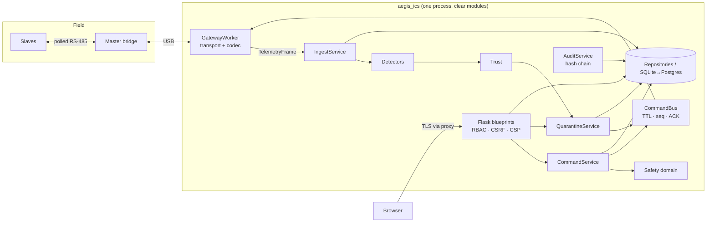
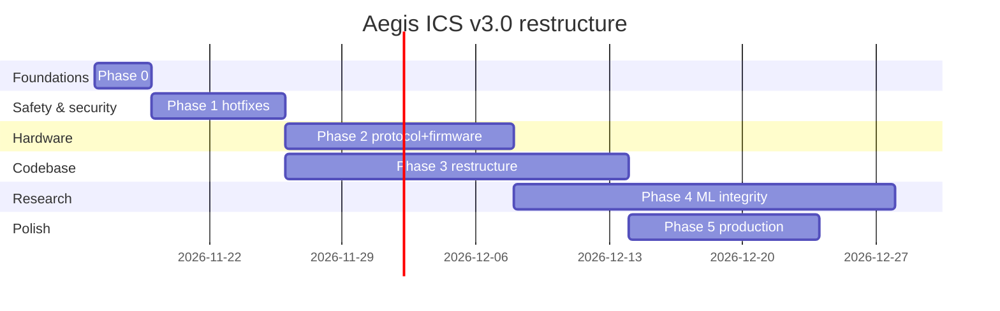

# Aegis ICS — Restructure Plan (v2.5 → v3.0)

| | |
|---|---|
| **Goal** | Turn a working research prototype into a codebase a senior engineer would approve: secure by default, honest about what's simulated, testable, packaged and maintainable. |
| **Inputs** | [Debug report](../07-reports/DEBUG_REPORT.md) (35 findings) · [Current architecture](../01-architecture/ARCHITECTURE.md) |
| **Approach** | Incremental strangler refactor. Every phase leaves the app runnable and the tests green. No big-bang rewrite. |
| **Owner / reviewers** | Project lead; at least one reviewer per PR |
| **Version target** | `3.0.0` (breaking: protocol, config and package layout change) |

---

## 0. Progress

| Phase | Status | Notes |
|---|---|---|
| 0 Foundations | **Done** (2026-11-14) | Git + tag `v2.5.3-baseline`; `src/version.py`; `pyproject.toml`; ruff + pre-commit; CI matrix + `pip-audit`; `tests/security/` regression suite. Deferred: lockfile (0.2) and mypy (0.3), both moving to Phase 3 with the package layout. |
| 1 Safety and security hotfixes | **Done** (2026-11-14) | All of 1.1–1.11 landed (see [DEBUG_REPORT fix status](../07-reports/DEBUG_REPORT.md#fix-status-updated-2026-11-15-v260dev0--restructure-plan-phases-02)). Deviations: 1.1 warns at startup and rejects frames per device instead of refusing to start, so the desktop app's first-run experience keeps working. 1.2's *forced* password change moves to Phase 3 with the account UI. 1.10 uses a `to_utc_epoch()` read helper rather than a column type change. 105 tests pass, 3 xfail. |
| 2 Hardware loop (zero-touch) | **Done in software** (2026-11-15) | 2.0–2.8 implemented: first-run setup, data directory, device registry + X25519 enrollment for N slaves, protocol v1 with ACKs and replay protection, polled bus, sensor faults, NVS trip state, v1 simulator, dynamic dashboard. Firmware compiles cleanly (core 3.3.12) and is compiled in CI. Still needed for the exit criteria: run it on hardware (`AEGIS_SELFTEST`, bench checklist, 24 h soak, 2.9 latency measurement). |
| 3 Restructure | Not started | Split `src/app.py` (~3,200 lines) into a package (blueprints + services + domain). |
| 4 ML integrity | **Attack classifier done** (2026-11-15, commits `bdb2095`, `b18875a`) | Trained offline attack-type classifier feeds the loss engine **and** the NIST report (Section 6). Still open under this heading: research-integrity work on the NSPN and trust score (synthetic-data caveats, NSPN command-type blind spot F6). |
| 5 Production polish | Not started | |

### Product-vision track (owner request, 2026-11-15)

A feature rebuild running alongside the structural phases above (see the product vision in memory / `docs/00-overview`). COM-port only; a non-engineer installs the `.exe`, plugs in hardware, and it works.

| Feature phase | Status | Notes |
|---|---|---|
| Per-device financials | **Done** (2026-11-15) | `src/financials.py` role profiles entered at approval; `src/attacks.py` catalog; `src/loss_engine.py` live incident loss (actual / projected / prevented / MTTR / restabilization / regulatory). `/api/financial/incident`. |
| USB attack-drill harness | **Done** (2026-11-15, commit `59e6744`) | `src/redteam.py` engine: localhost drill token, `run_physical_attack` crafts malicious signed telemetry from a "compromised" device and drives the real detect/quarantine/loss pipeline; 8-stage `CAMPAIGN`; `reset()`. Machine endpoints `/api/redteam/{plan,inject,reset,status}` (localhost + token, CSRF-exempt). App publishes live port + token to the data dir on start (`write_runtime_info`). `tools/redteam/` = stdlib-only portable runner + `run_drill.bat` + README (copy folder to a USB, double-click). Verified end-to-end: 8/8 defended, $427.5k prevented. |
| Station 04 live campaign view | **Done** (2026-11-15, commit `3ef542e`) | Dashboard front for the harness. Operator endpoints `/api/campaign/{plan,stage,reset}` (login + CSRF); `redteam.run_perimeter_selftest` + `run_stage`. Station 04 rebuilt: Launch/Restore controls, KPI row (defended / downtime cost / catastrophe prevented), 8 live stage rows (PENDING→RUNNING→DEFENDED/BREACH + per-stage financials). Verified in-browser (XP themed). |
| Attack-type ML classifier | **Done** (2026-11-15, commit `bdb2095`) | `src/train_classifier.py` trains a 5-class Random Forest (normal / fdi_spike / stuxnet / thermal_drift / sensor_fault) on the 5 sensors; envelopes centred on the harness profiles (96.3% acc / 0.96 macro-F1). `src/model/attack_classifier.pkl` (+ sha256 + meta). `src/detection.py` loads it read-only (SHA-256 verified); `detect_device()` names the physical attack from a device's telemetry, abstains on normal/protocol attacks. `app._current_detections` feeds `{attack_type, confidence}` to the loss engine; `/api/model/status` exposes the card. Deterministic rules/trust still *trigger* quarantine; the classifier *names* the attack. |
| XP (Luna) reskin | **Foundation done** | `src/static/xp.css`; templates link it. Pending polish: digital-twin SVG tiles still dark (JS-set fills); `login.html`/`setup.html` copy still terminal-flavoured ("DEC VT-220", "TTY-01"). |
| Aggregate SCADA graph | **Done** (2026-11-15, commit `a8b5535`) | Station 01 aggregate card fusing all slaves × all 5 sensors, switchable RADAR ↔ GROUPED BAR (`renderAggregateChart` / `setAggregateMode` in dashboard.html). Each sensor normalised to its nominal ceiling (100% = envelope limit); isolated nodes dashed red; a node past the 100% ring = out of envelope. Reads live `currentDevices` (no new endpoint). Verified in-browser both views + under attack. |
| NIST SP 800 report upgrade | **Done** (2026-11-15, commit `b18875a`) | New report Section 6 "Active Cyber-Physical Incidents — ML Classification, Loss Accounting & Mitigation": per incident shows the ML-named attack (+ confidence + MITRE), loss-engine figures (actual / projected / prevented / time-to-fix / restabilization), posture totals, and an ML-driven mitigation + recovery plan with NIST controls; classifier model card; clean no-incident state. `reporting.generate_incident_report_pdf(..., detections=)` now wired to `loss_engine` + `detection`; `/api/report/*` pass `_current_detections(db)`. Sections renumbered → 11 total. |
| Ship | Not started | Browser-sweep every station, rebuild `.exe`, package for a non-engineer, hand to the hardware engineer for the bench test. |

**Suggested next order:** ~~ML classifier~~ → ~~aggregate SCADA graph~~ → ~~NIST report upgrade~~ (all done) → **XP polish** → **rebuild `.exe` + handoff** (Phase 9). Phase 3 (restructure) can slot in anytime.

---

## 1. Guiding principles

1. **Safety first, then security, then structure, then features.** Fix what can hurt someone before moving files.
2. **Every finding gets a regression test before its fix** (test-first for bugs).
3. **One source of truth** for version, config, device registry, limits and the protocol.
4. **No side effects at import.** Everything starts from an app factory.
5. **Simulation is a first-class mode, never mixed with production data.**
6. **The docs move with the code.** Each PR updates `docs/`.

---

## 2. Target repository layout

```text
aegis-ics/
├── pyproject.toml                 # PEP 621 metadata, deps + extras [desktop, ml, dev], tool config (ruff, mypy, pytest, coverage)
├── README.md                      # short, honest, links into docs/
├── CHANGELOG.md                   # Keep a Changelog format
├── SECURITY.md · CONTRIBUTING.md · CODEOWNERS · LICENSE
├── .pre-commit-config.yaml        # ruff, ruff-format, mypy, end-of-file, detect-secrets
├── .github/workflows/
│   ├── ci.yml                     # lint → type → unit → integration → security scan (bandit, pip-audit) → coverage
│   ├── firmware.yml               # PlatformIO build + Unity tests
│   └── release.yml                # build wheels, PyInstaller (Win/Linux), .deb, SBOM, signed checksums
│
├── src/aegis_ics/                 # installable package (src layout)
│   ├── __init__.py                # __version__ (single source)
│   ├── __main__.py                # `python -m aegis_ics` → cli
│   ├── cli.py                     # typer/argparse: serve, desktop, gateway, simulate, train, db upgrade, user add
│   ├── config.py                  # pydantic-settings Settings (env + .env + file), validated at startup
│   ├── logging.py                 # structured JSON logging setup
│   │
│   ├── domain/                    # pure Python, no Flask/SQLAlchemy imports
│   │   ├── models.py              # dataclasses: TelemetryFrame, Command, DeviceId, TrustScore, Verdict
│   │   ├── limits.py              # SAFETY_LIMITS, coupling invariants (one copy)
│   │   ├── trust.py               # trust math (from trust_engine.py)
│   │   ├── safety.py              # enforcer pipeline (from safety_enforcer.py)
│   │   ├── anomaly.py             # rule checks + detector interface
│   │   └── risk.py                # FAIR math (from analytics.py), real Monte Carlo
│   │
│   ├── protocol/                  # wire format, shared with firmware via generated header
│   │   ├── schema/*.json          # JSON Schemas: telemetry v1, command v1, ack v1, topology v1
│   │   ├── codec.py               # parse/serialise, canonicalise, sign/verify, seq/replay window
│   │   └── vectors/*.json         # test vectors used by pytest AND firmware Unity tests
│   │
│   ├── services/                  # use-cases; orchestrate domain + persistence + gateway
│   │   ├── ingest.py              # TelemetryIngestService (was process_telemetry)
│   │   ├── quarantine.py          # isolate / rejoin / shutdown with policy + audit
│   │   ├── commands.py            # CommandService: validate → enqueue with TTL+seq → await ACK
│   │   ├── devices.py             # registry, topology view (dedupes /api/devices + /api/cluster/topology)
│   │   ├── audit.py               # append-only, hash-chained writer + query
│   │   ├── reports.py             # PDF generation (from reporting.py)
│   │   └── models_admin.py        # model status, guarded retrain, promotion
│   │
│   ├── ml/                        # runtime inference only
│   │   ├── rf_detector.py         # LocalRFModel (fast tree walk), loads signed skops/ONNX artifact
│   │   ├── nspn.py                # NeuralSafetyPolicy (+ command-type one-hot)
│   │   └── artifacts.py           # signature verification (ed25519), manifest
│   │
│   ├── gateway/
│   │   ├── transport.py           # SerialTransport, MockTransport (same interface)
│   │   ├── worker.py              # GatewayWorker: own stop event, join(), backoff, metrics
│   │   ├── command_bus.py         # outbound queue with TTL, seq, ACK tracking
│   │   └── simulator.py           # plant simulator + attack injector (writes is_simulated=True everywhere)
│   │
│   ├── persistence/
│   │   ├── db.py                  # engine, session_scope(), SQLite pragmas
│   │   ├── orm.py                 # tables incl. NEW devices, roles, audit hash chain, command_log
│   │   ├── repositories/*.py      # TelemetryRepo, AuditRepo, DeviceRepo, RuleRepo, UserRepo
│   │   └── migrations/            # Alembic (the ONLY schema path)
│   │
│   ├── web/
│   │   ├── app_factory.py         # create_app(settings) – registers blueprints, extensions, security headers
│   │   ├── security.py            # login, RBAC decorators, CSRF, CSP, rate limits
│   │   ├── blueprints/            # auth, ingest, control, devices, gateway, audit, analytics, reports, stream, admin, meta
│   │   ├── schemas.py             # request/response validation (pydantic)
│   │   ├── templates/             # Jinja: base.html + one partial per station
│   │   └── static/
│   │       ├── js/                # ES modules: api.js, sse.js, charts.js, escape.js, stations/*.js
│   │       ├── css/
│   │       └── vendor/
│   │
│   └── desktop/                   # optional extra [desktop]
│       ├── app.py                 # PyWebView launcher (was main.py)
│       ├── tray.py
│       └── updater.py             # disabled when settings.air_gapped
│
├── ml/                            # offline research & training, NOT shipped in runtime wheel
│   ├── datasets/README.md         # how to obtain SWaT / WADI / HAI; synthetic generator kept as baseline
│   ├── training/{rf.py, nspn.py, synthetic.py}
│   ├── evaluation/{metrics.py, scenarios.py}
│   └── notebooks/
│
├── firmware/
│   ├── platformio.ini             # envs: master, slave_001..004
│   ├── lib/aegis_protocol/        # generated protocol.h, canonicaliser, HMAC verify, seq window
│   ├── src/master_bridge/main.cpp # master polling scheduler, ACK relay
│   ├── src/slave_sensor/main.cpp  # verified commands, fault flags, NVS keys, watchdog, persisted trip state
│   └── test/                      # Unity tests using protocol/vectors
│
├── benchmarks/                    # from tests/benchmark_suite.py + generate_graphs.py
├── packaging/
│   ├── pyinstaller/{windows.spec, linux.spec}
│   ├── debian/                    # non-root service user, hardened unit
│   └── scripts/{build.py, package_deb.py, package_tarball.py}
├── deploy/
│   ├── systemd/aegis-ics.service  # User=aegis, ProtectSystem=strict, DeviceAllow
│   ├── caddy/Caddyfile            # TLS reverse proxy example
│   └── docker/{Dockerfile, compose.yml}   # server mode + simulator for demos/CI
├── tests/                         # unit/ integration/ security/ contract/ e2e/ hardware/ + conftest.py
└── docs/                          # this documentation tree
```

### 2.1 File migration map (old → new)

| Current file | Goes to | Notes |
|---|---|---|
| `src/app.py` (1,967 lines) | `web/app_factory.py`, `web/blueprints/*`, `services/ingest.py`, `services/quarantine.py`, `services/commands.py`, `ml/rf_detector.py` | the biggest job; done route group by route group |
| `src/database.py` | `persistence/db.py`, `persistence/orm.py`, `cli.py` (`user add`, `db upgrade`) | seeding of users and fake audit rows removed |
| `src/security.py` | `config.py` (keys), `web/security.py` (decorators), `desktop/app.py` (port, debugger) | `DEFAULT_DEVICE_KEYS` deleted |
| `src/serial_gateway.py` | `gateway/transport.py`, `gateway/worker.py`, `gateway/command_bus.py`, `gateway/simulator.py`, `protocol/codec.py` | |
| `src/trust_engine.py` | `domain/trust.py` + `services/devices.py` | DB queries leave the math |
| `src/safety_enforcer.py` | `domain/safety.py` | takes a `StateSnapshot`, not a DB session |
| `src/neural_policy.py` | `ml/nspn.py` | |
| `src/train_model.py` | `ml/training/*` (offline) + `services/models_admin.py` (guarded retrain) | |
| `src/analytics.py` | `domain/risk.py` + `services/` | |
| `src/reporting.py` | `services/reports.py` | |
| `src/main.py`, `tray.py`, `updater.py` | `desktop/` | |
| `src/templates/dashboard.html` | `web/templates/*.html` + `web/static/js/**` | JS extracted to modules |
| `src/alembic/` | `persistence/migrations/` | wired into `cli db upgrade` and startup |
| `src/model/*` | `src/aegis_ics/ml/artifacts/` (shipped) + manifest with signatures | |
| `build_scripts/`, `debian/` | `packaging/`, `deploy/` | |
| `tests/benchmark_suite.py`, `generate_graphs.py` | `benchmarks/` | |
| `.env.example` | rewritten from `Settings` (only real variables) | |

---

## 3. Target runtime architecture



Key changes:
- **No loopback HTTP**: the gateway hands frames to `IngestService` in-process. `/api/telemetry` stays only for external gateways, behind an API key or mTLS, and is disabled by default.
- **Commands have a lifecycle**: `PENDING → SENT → ACKED | EXPIRED | REJECTED`, stored in `command_log` and shown in the UI.
- **Device registry**: a `devices` table (id, name, zone, criticality, key fingerprint, per-device limits, enabled). It replaces five hard-coded lists.
- **Simulation mode**: `settings.mode = production | simulation`. In simulation the DB file is separate and the UI shows a persistent banner.

---

## 4. Phased plan

Effort estimates assume one developer familiar with the code. "Exit criteria" must all hold before the next phase starts.

### Phase 0 — Foundations (2–3 days)
| # | Task | Fixes |
|---|---|---|
| 0.1 | Initialise git, add `.gitignore` (DB, `.aegis_session_key`, `dist/`, `*.pkl` under review), tag current state `v2.5.3-baseline` | – |
| 0.2 | `pyproject.toml` with dependencies and extras; drop unused `paho-mqtt` and `pandas`; pin with `uv lock` or `pip-tools` | R5 |
| 0.3 | Add ruff, ruff-format, mypy (lenient), pre-commit; reformat the whole tree once in a dedicated commit | code hygiene |
| 0.4 | CI workflow: lint + current tests on Windows and Ubuntu, Python 3.11 and 3.12 | – |
| 0.5 | Add `tests/security/` with one **failing** test per debug-report finding, marked `xfail(strict=True)`. Each fix flips one to pass. | all |
| 0.6 | Single version source; `CHANGELOG.md` | R5 |

**Exit:** CI green; xfail list shows every known bug; formatting noise is out of the way.

### Phase 1 — Stop the bleeding: safety and security hotfixes (1 week)
| # | Task | Fixes |
|---|---|---|
| 1.1 | Remove `DEFAULT_DEVICE_KEYS` and the fallback key; refuse to start without a key for each registered device; reject unknown `device_id` | S2 |
| 1.2 | First-run admin bootstrap (`aegis-ics user add --admin` or a printed one-time password plus forced change); delete the `noodles` user; remove the test that expects it | S4 |
| 1.3 | Gateway: per-device keys only (`hmac_key=None`); never sign frames on the device's behalf (unsigned means rejected) | F1, S6 |
| 1.4 | Ingest: no auto-quarantine from a single unauthenticated failure; failure counter per device and window; restrict `/api/telemetry` to localhost plus a shared token until Phase 3 removes it | S1 |
| 1.5 | Escape all dashboard output (`escapeHtml` helper); `bleach` the login username; add a CSP header | S7 |
| 1.6 | COM connect no longer clears quarantine | S8 |
| 1.7 | `/api/setpoint` fails if no gateway is connected; queued commands get a TTL (default 5 s) and are dropped when stale | F3 |
| 1.8 | Separate simulation: `/api/simulate-attack` writes `is_simulated=True` audit rows (new column) or uses the simulation DB; remove seeded fake audit rows; reports exclude simulated data | R1, R2 |
| 1.9 | `require_webview_token` and `csrf_protect` no longer depend on `TESTING`; update the tests to send tokens | test integrity |
| 1.10 | Small correctness fixes: ISO timestamp handling, audit UTC (`DateTime(timezone=True)` + explicit UTC conversion), `limit` parsing, ping marked "not implemented" | F8, F9, F10, F14 |
| 1.11 | Debian unit: dedicated `aegis` user in `dialout`, bind 127.0.0.1, hardening directives | S1 |

**Exit:** all S-level CRITICAL/HIGH xfails that don't need firmware pass; the security regression suite runs in CI with security **on**.

### Phase 2 — Make the hardware loop real, zero-touch (revised 2026-11-14)

**Revision.** Keys must never need a manual step, the number of slaves isn't known in advance, and the packaged `.exe` must work on first launch. Phase 2 therefore replaces "key provisioning tool" with **automatic discovery plus one-click enrollment** ([ADR 0006](../adr/0006-zero-touch-enrollment.md)) and adds a **first-run setup** for the desktop app.

| # | Task | Fixes |
|---|---|---|
| 2.0 | **Zero-touch enrollment for N slaves.** One firmware image for every slave (no per-node config). On first boot a slave derives its ID from its MAC and generates an X25519 key pair in NVS. It announces `HELLO` (ID, public key, sensors). The host lists it as **Pending** with a fingerprint; an operator clicks **Approve**; host and slave derive the HMAC key with X25519 + HKDF-SHA256 (the key never crosses the bus). A `devices` registry table replaces every hard-coded node list. | S2, scalability |
| 2.1 | Protocol v1 (`HELLO`, `WELCOME`, `TEL`, `CMD`, `ACK`, `POLL`), with `v`, `boot`, `seq` and `sig`. Canonical signing shared by host, simulator and firmware; test vectors in `tests/`. | S5, F2 |
| 2.2 | Firmware verifies command HMAC + host sequence number; implements `SETPOINT` (stored target + PWM actuator outputs); answers every command with a signed `ACK` | S3, F2 |
| 2.3 | Master-polled bus: the bridge polls each known slave in turn and opens a discovery slot periodically; slaves only transmit when addressed | F5 |
| 2.4 | Sensor fault detection: floating/out-of-range ADC sends `null` + `faults[]`; the host treats a fault as an anomaly | F7 |
| 2.5 | Trip state persisted in NVS (a tripped node boots tripped); hardware watchdog | firmware.md |
| 2.6 | First-run setup for the packaged app: create the admin account in a setup screen (one-time token, opened automatically by the desktop app); session key, host identity and models live in the writable data directory | `.exe` usability |
| 2.7 | Gateway hands frames to ingestion in-process ([ADR 0003](../adr/0003-in-process-ingestion-no-loopback-http.md)); command bus with per-device sequence numbers and ACK tracking (`command_log`) | F3, F4 |
| 2.8 | Simulator speaks protocol v1 for N devices (`AEGIS_SIM_DEVICES`), including enrollment, ACKs, setpoints and faults | demo/test realism |
| 2.9 | Measure end-to-end trip latency with a logic analyser on GPIO25; publish the histogram | R4 |

**Exit:** a fresh `.exe` reaches a working dashboard with no command-line step; a new slave plugged into the bus appears as Pending and streams signed telemetry after one click; a setpoint is applied on hardware and ACKed; replayed frames are rejected on both sides; N slaves run 24 h without collisions.

### Phase 3 — Restructure the codebase (2–3 weeks)
Done as a strangler: create `src/aegis_ics/`, move one slice at a time, and keep thin shims in the old modules until the last caller is gone.

| # | Slice | Steps |
|---|---|---|
| 3.1 | Config and logging | `Settings` (pydantic-settings); replace every `os.environ.get`; JSON logs; remove `print` |
| 3.2 | Persistence | `session_scope()`, repositories, Alembic as the only schema path; new tables `devices`, `roles`, `user_roles`, `command_log`; indexes on `(device_id, timestamp)` |
| 3.3 | Domain | move the trust, safety, risk and anomaly math into pure functions; 100 % unit-test coverage there |
| 3.4 | Services | ingest, quarantine, commands, devices, audit (hash chain), reports |
| 3.5 | Web | `create_app()`; blueprints per route group; pydantic request schemas; consistent JSON errors (401 instead of redirect for `/api/*`); OpenAPI generated from the schemas (e.g. `spectree` or `flask-smorest`) |
| 3.6 | RBAC | roles: viewer, operator, engineer, admin. Decorator `@requires("engineer")`. Two-person approval for rules, rejoin and retrain |
| 3.7 | Gateway | move into `gateway/`, in-process hand-off to `IngestService`; drop loopback HTTP |
| 3.8 | Frontend | split `dashboard.html` into `base.html` + 7 station partials; extract JS to ES modules; no inline script, strict CSP |
| 3.9 | Desktop | move to `desktop/`; `air_gapped` setting disables the updater |
| 3.10 | Packaging | PyInstaller specs point at the package; `.deb` from `packaging/`; Docker image for server and simulator |
| 3.11 | Delete the old `src/*.py` shims | – |

**Exit:** `app.py` gone; no module above 400 lines; `mypy --strict` passes on `domain/`, `protocol/` and `services/`; coverage ≥ 80 %.

### Phase 4 — ML and research integrity (2–4 weeks, can overlap Phase 3)
| # | Task | Fixes |
|---|---|---|
| 4.1 | Move training to `ml/` (not shipped). Artifacts in skops/ONNX, signed with an offline ed25519 key; runtime verifies the signature | S10 |
| 4.2 | NSPN v2: add a command-type one-hot (or two models); per-device envelopes; physics-model-generated labels | F6 |
| 4.3 | Evaluate the RF on SWaT/WADI/HAI (or a recorded hardware dataset); report per-attack precision, recall and detection delay; keep the synthetic results as a labelled baseline | R3 |
| 4.4 | Replace self-labelled retraining with operator-labelled samples, shadow evaluation and a promotion gate | S10 |
| 4.5 | Real Monte Carlo for FAIR (frequency × magnitude sampling) or rename the function | analytics |
| 4.6 | Update `paper-draft.md` and the README with measured numbers only; reconcile every metric | R3–R6 |

### Phase 5 — Production polish (1–2 weeks)
- Postgres support (SQLAlchemy URL) plus a telemetry retention/downsampling job.
- Gunicorn/Waitress in server mode; SSE via a pub/sub fan-out instead of per-client DB polling.
- Prometheus `/metrics` (ingest rate, rejects by reason, queue depth, ACK latency).
- Modbus RTU/TCP and OPC UA adapters behind the transport interface.
- Playwright e2e tests against the simulator in CI.
- SBOM (CycloneDX) and signed release checksums.

---

## 5. Timeline (indicative)



Phase 2 (firmware) and Phase 3 (host code) can run in parallel once the protocol spec (2.1) is agreed.

---

## 6. Risks and mitigations

| Risk | Impact | Mitigation |
|---|---|---|
| Big moves break the PyInstaller build | release blocked | build the exe in CI from Phase 0; smoke-test `--check` |
| Protocol v1 breaks deployed firmware | nodes rejected | `v` field; host accepts v0 frames behind a `legacy_protocol` flag for one release |
| Hidden behaviour in the 2,200-line dashboard | UI regressions | Playwright snapshot tests before extracting JS |
| Paper numbers change after honest evaluation | research timeline | keep synthetic results as a clearly labelled baseline; add real-data results as a new section |
| Scope creep | never finishes | phases are independently shippable; ship 2.6 (Phase 1) as soon as it's done |

---

## 7. Definition of done for v3.0

- [ ] Every finding in the debug report is closed or explicitly accepted in writing.
- [ ] No default credentials or keys anywhere in the repository (`detect-secrets` in CI).
- [ ] Tests run with all security controls enabled; coverage ≥ 80 %; CI green on Windows and Linux.
- [ ] Setpoint → ACK round-trip demonstrated on hardware; trip latency measured and published.
- [ ] The docs tree matches the code (architecture, API from OpenAPI, configuration from `Settings`).
- [ ] The README contains only verifiable claims.

---

## 8. Tracking

Create one GitHub issue per task ID (e.g. `P1.3 gateway per-device keys`), labelled `phase-N` plus `security`/`safety`/`refactor`/`research`, and linked to the debug-report finding. Use a project board with the columns Backlog → In progress → Review → Done.
